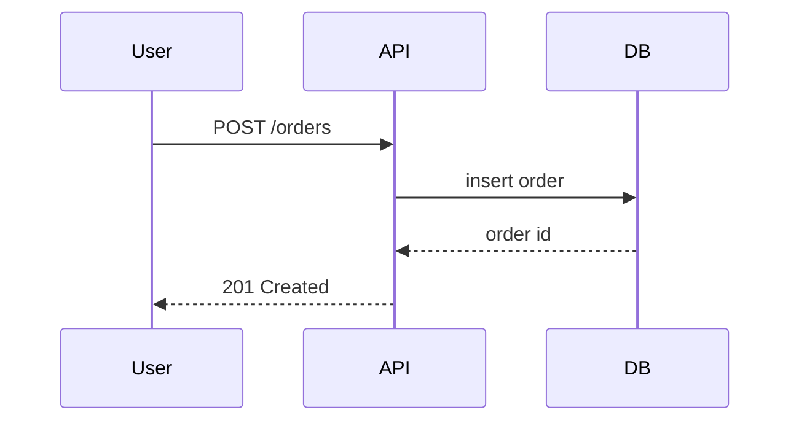

# Diagrams and charts

## Decide whether to draw

Draw a visual only when it shows something prose cannot show quickly: structure, order, or the shape of numbers. Two boxes and one arrow do not need a diagram. Three numbers fit in a sentence.

## Diagrams: use Mermaid

Write diagrams as Mermaid text, so they diff in git and render in GitHub, many editors and most report toolchains.

| You want to show | Mermaid type |
|---|---|
| Components and how they connect (architecture) | `flowchart LR` with `subgraph` per boundary |
| Steps and decisions in a process | `flowchart TD` |
| Messages between actors over time | `sequenceDiagram` |
| States and transitions | `stateDiagram-v2` |
| Data entities and relations | `erDiagram` |

Rules:

- Label every arrow with what flows along it, such as `-->|HTTP request|`.
- Use the names from the code or the domain, not generic names like "Service A".
- Keep one diagram to about 12 nodes or fewer. Split larger systems into an overview and detail diagrams.
- Do not set colors in diagrams unless color carries meaning. Default themes stay readable in light and dark mode.

Example:

## Charts: pick by the question

| Question | Chart |
|---|---|
| How does a value change over time? (trend) | Line chart. Use bars for a few discrete periods. |
| Which item is bigger? (comparison) | Bar chart, sorted, horizontal when labels are long. |
| What share does each part have? (composition) | Stacked bar, or a 100 percent stacked bar across groups. Use a pie only for 2 or 3 parts. |
| How are values spread? (distribution) | Histogram, or a box plot to compare groups. |
| Do two measures move together? (relationship) | Scatter plot. |

Rules:

- Title the chart with the finding, such as "Revenue grew 18 percent in Q3", not "Revenue".
- Label both axes with the measure and the unit, such as "Revenue (USD millions)".
- Start bar chart value axes at zero. Line charts may start elsewhere if the axis says so.
- Name the data source and its date under the chart.
- Keep every chart readable in light and dark mode. Use a transparent or explicit background, text and gridlines with enough contrast in both, and a colorblind-safe palette. Never rely on red versus green alone.
- Use direct labels instead of a legend when there are few series.

## Always ship the numbers

Never present a chart without the numbers it shows. Put the data next to the chart as a table, a CSV file, or the script that produced it. A reader must be able to check every value.

Produce charts from a script (Python with matplotlib or Vega-Lite, for example) that reads a data file, so the chart can be regenerated. Commit the script and the data together with the image.

## Checks before you finish

- Does the visual answer the question you picked it for?
- Do all arrows, axes and series have labels and units?
- Is the data source named, and is the data available beside the chart?
- Does it read in both light and dark mode?
